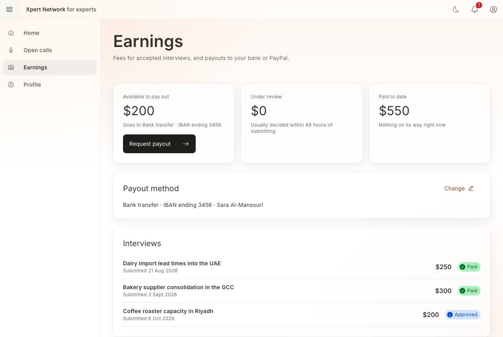
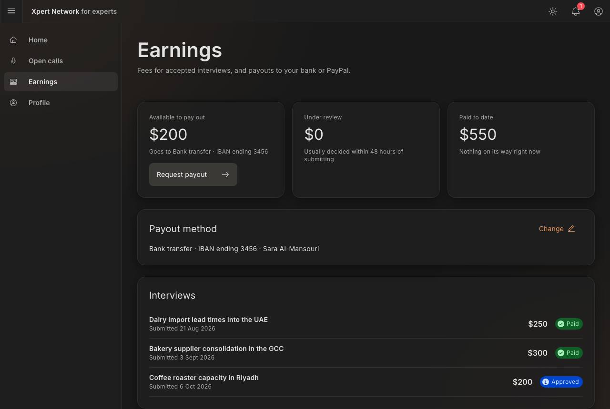
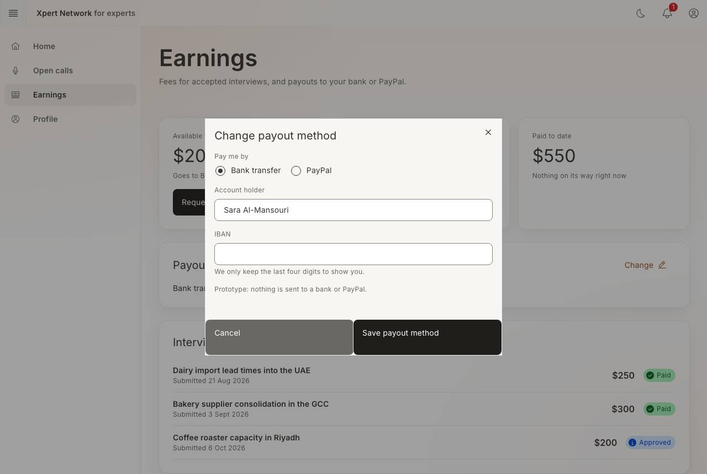
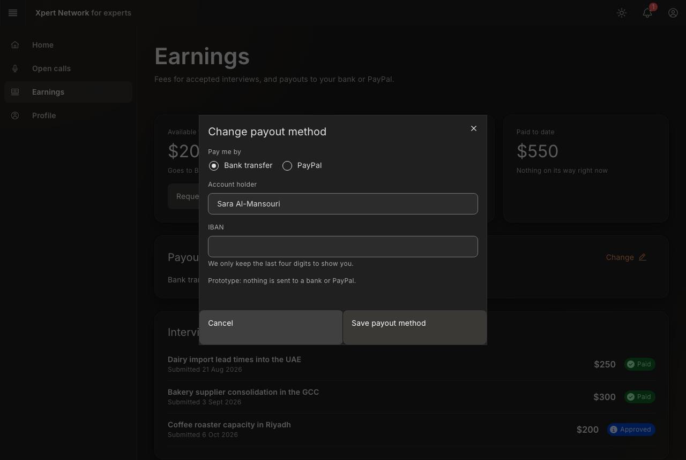

# F10 Expert earnings and payout request

- Status: Built (prototype) · 2026-10-16
- Route: `/expert/earnings`
- Feature: `src/features/earnings` · Mock: `src/mocks/handlers/earnings.handlers.ts`, `src/mocks/fixtures/earnings.ts`
- E2E: `e2e/F10-earnings.spec.ts`

## Screen

| Area          | Key elements                                                                                                                                                               |
| ------------- | -------------------------------------------------------------------------------------------------------------------------------------------------------------------------- |
| Totals        | **Available to pay out** (approved, not yet requested) with **Request payout**; **Under review**; **Paid to date** with what's on its way                                  |
| Payout method | Masked label only (“Bank transfer · IBAN ending 3456”), holder; **Change** → bank (IBAN, validated) or PayPal (email). Only the last four digits / a masked email are kept |
| Interviews    | Each interview: title (links to it), submitted date, note (e.g. paid pro rata), fee, status (Under review · Approved · Paid · Not accepted)                                |
| Payouts       | Amount, method, requested / paid date                                                                                                                                      |

Payouts need a method and at least $100 available; a request takes everything available.

## States and how to reach them

| State                         | How                                                             |
| ----------------------------- | --------------------------------------------------------------- |
| New expert                    | _Empty data_ (“No earnings yet” → Browse open calls)            |
| Fee pending → approved        | Submit an interview (F9), then **Accept interview**             |
| Payout requested → paid       | **Request payout**, then **Payout paid** (notification + toast) |
| Below the minimum / no method | Request disabled with the reason under the total                |
| Loading / error               | _Slow network_ / _API error_                                    |

## Screenshots

1280 × 860, light and dark. Checked at 320px, for visible focus on each Tab stop, and with axe in both themes.

| Screen        | Light                                                            | Dark                                                           |
| ------------- | ---------------------------------------------------------------- | -------------------------------------------------------------- |
| Earnings      |            |            |
| Payout method |  |  |
