# F17 Profile, settings and notifications (all roles)

- Status: Built (prototype) · 2026-10-15
- Routes: client `/settings?tab=profile|notifications|security|appearance`; expert `/expert/profile?tab=expertise|profile|notifications|security|appearance`. Notification centre in every role’s header (admin included).
- Features: `src/features/profile` (`SettingsView`), `src/features/notifications` (`NotificationCentre`) · Mock: `src/mocks/handlers/profile.handlers.ts`, `src/mocks/handlers/notifications.handlers.ts`, `src/mocks/fixtures/{profile,notifications}.ts`
- E2E: `e2e/F17-settings.spec.ts`

## Notification centre (Carbon `HeaderPanel`)

| Element      | Behaviour                                                                                                                                         |
| ------------ | ------------------------------------------------------------------------------------------------------------------------------------------------- |
| Bell         | `HeaderGlobalAction`; icon switches to _NotificationNew_ and shows a count badge when unread; label “Notifications, 2 unread”                     |
| Panel        | Newest first; unread items have a dot, a raised background and “(unread)” for screen readers; title, one-line body, relative time (full on hover) |
| Open an item | Marks it read (optimistic) and goes to its page                                                                                                   |
| Mark all     | **Mark all as read** (disabled when nothing is unread)                                                                                            |
| Footer       | **Notification settings** → the role’s Notifications tab (hidden during onboarding and for admins)                                                |
| New arrival  | Polls every 30 s; a notification that arrives while the app is open also shows as a toast (8 s, `role="status"`)                                  |

## Settings tabs (`Tabs`, tab kept in the URL)

| Tab                                     | Content                                                                                                                                                                                   |
| --------------------------------------- | ----------------------------------------------------------------------------------------------------------------------------------------------------------------------------------------- |
| Expert profile (expert)                 | The vetted F7 profile, read-only, with how to request changes (re-review)                                                                                                                 |
| Profile / Account                       | Name, job title (headline for experts), organisation, email (read-only; change via support), phone (international format), time zone → **Save details** / **Discard changes**             |
| Research interests (client, on Profile) | Industries and regions from onboarding (F1) → **Save interests**                                                                                                                          |
| Notifications                           | Per event: Email and In-app checkboxes (events differ by role); email frequency (as it happens / daily / weekly) → **Save notification settings**. Account and security emails always go. |
| Security (mocked)                       | Password (last changed; change form with rules), two-step verification (`Toggle` → code `Modal`), where you’re logged in (sign out one / all others)                                      |
| Appearance                              | Theme: match my device / light / dark (applies immediately; saved on this device; same setting as the header toggle)                                                                      |

Save buttons are disabled until something changes; success and failure show inline, and a failed save keeps the edits.

## States and how to reach them

| State                                     | How                                                                    |
| ----------------------------------------- | ---------------------------------------------------------------------- |
| Panel / tab loading skeletons             | Toolbar _Slow network_                                                 |
| Panel or tab failed to load (retry)       | Toolbar _API error_                                                    |
| Save failed (edits kept)                  | _API error_ on, then save                                              |
| No notifications (“You’re all caught up”) | Toolbar _Empty data_                                                   |
| Only this device signed in                | Toolbar _Empty data_ → Security; or **Sign out of all other sessions** |
| New notification + toast                  | Toolbar **Scenarios → Push notification** (role-specific content)      |
| Wrong current password                    | Change password with current password `wrong-password`                 |
| Two-step code rejected                    | Turn on two-step verification with code `000000`                       |
| Field validation                          | Phone without a country code; mismatched new passwords                 |

Expert approvals and rejections from the toolbar (F7) also arrive as notifications.

## Decisions

- One settings surface per role; the expert’s lives under **Profile** in the side nav and opens on the read-only expert profile.
- Notification preferences are per event and per channel, not one global switch, so experts can keep call matches on while muting product news.
- Email is read-only in the prototype; changing it needs re-verification, which isn’t designed yet.
- Theme preference stays device-local (as before); other settings are account-level (mock backend).

## Screenshots

1280 × 860, light (white) and dark (g100). Regenerated 2026-10-15; every screen was also checked at 320px (no horizontal scroll) and for a visible focus stop on each Tab.

| Screen                        | Light                                                                                | Dark                                                                               |
| ----------------------------- | ------------------------------------------------------------------------------------ | ---------------------------------------------------------------------------------- |
| Notification centre           | 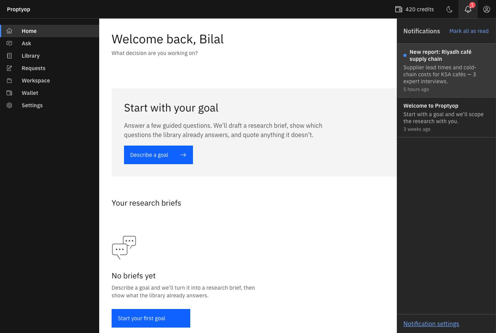         | 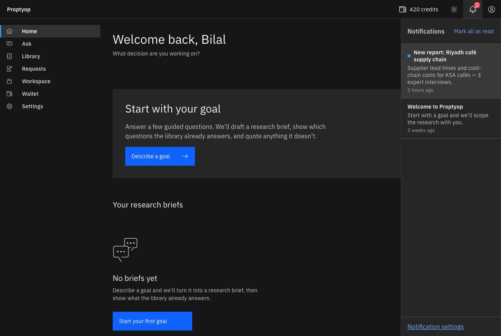         |
| Settings · Profile            | 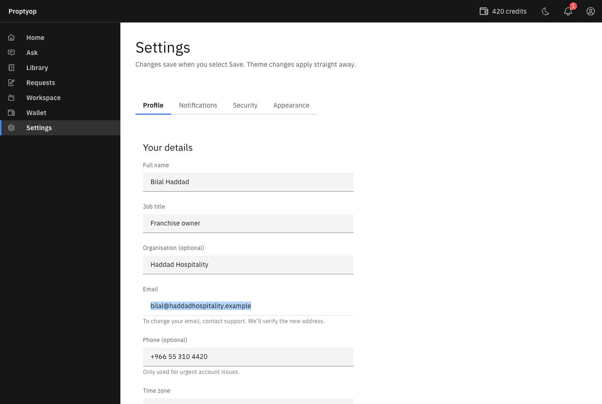             | 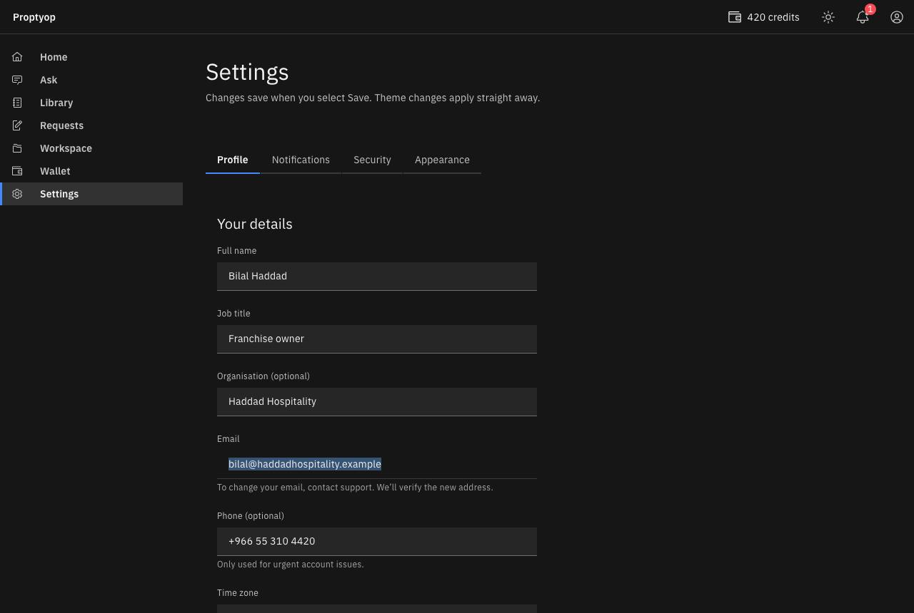             |
| Settings · Notifications      | 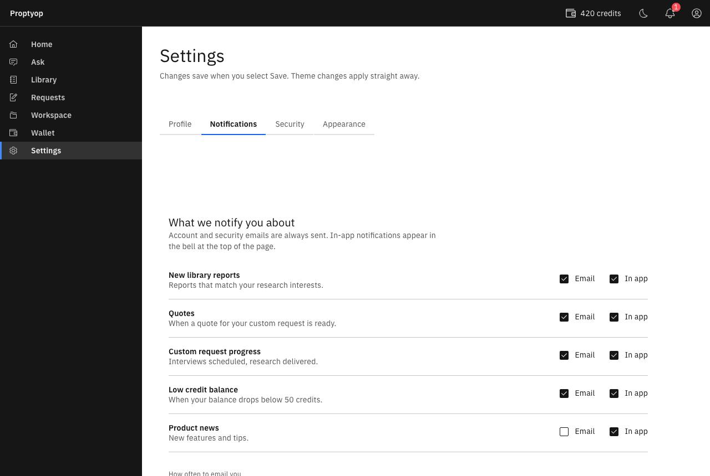 | 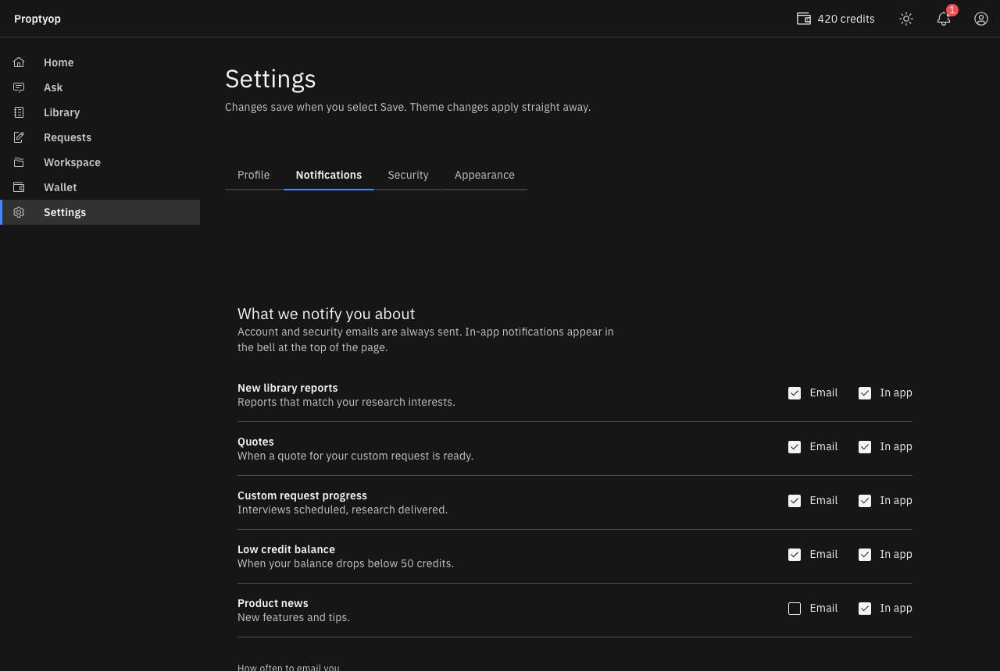 |
| Settings · Security           | 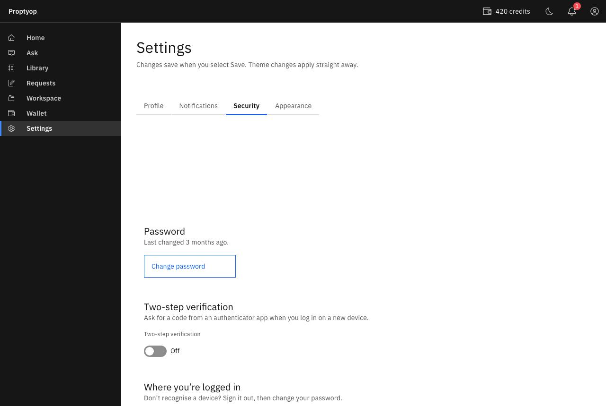           | 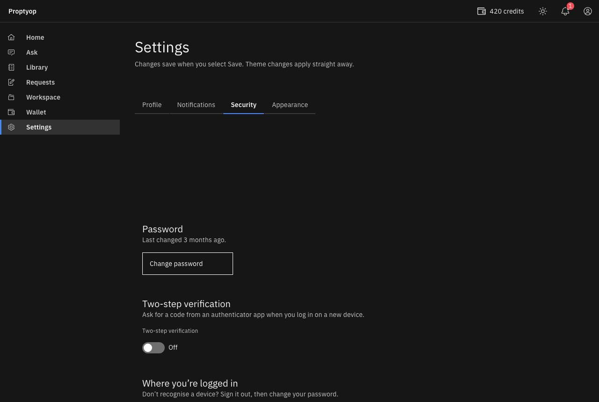           |
| Settings · Appearance         | 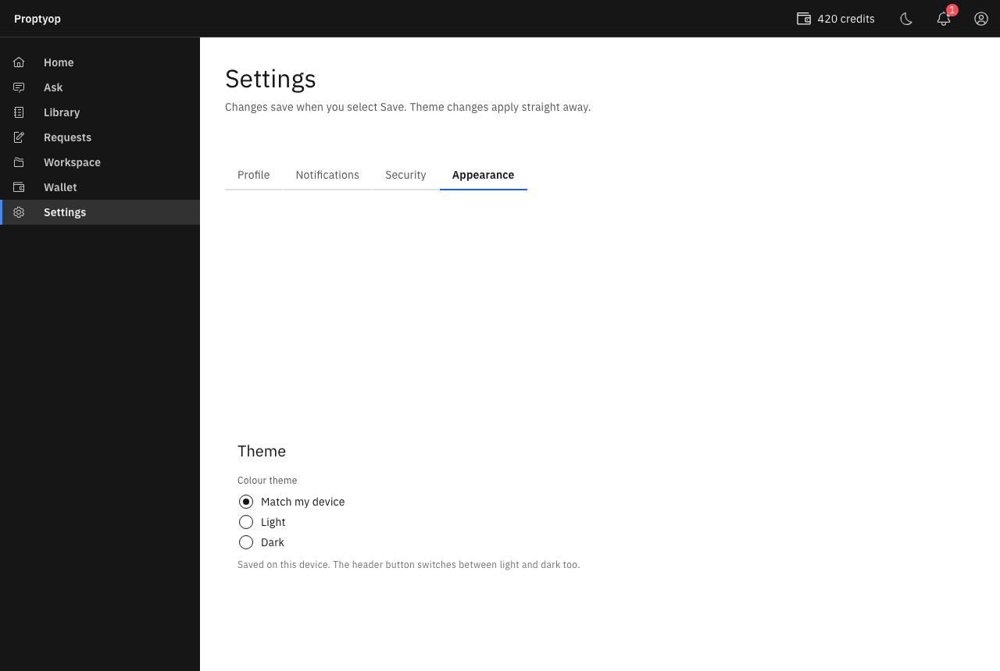       | 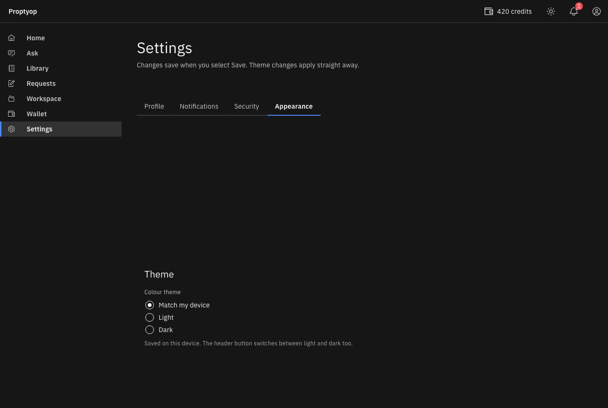       |
| Expert · Profile and settings | 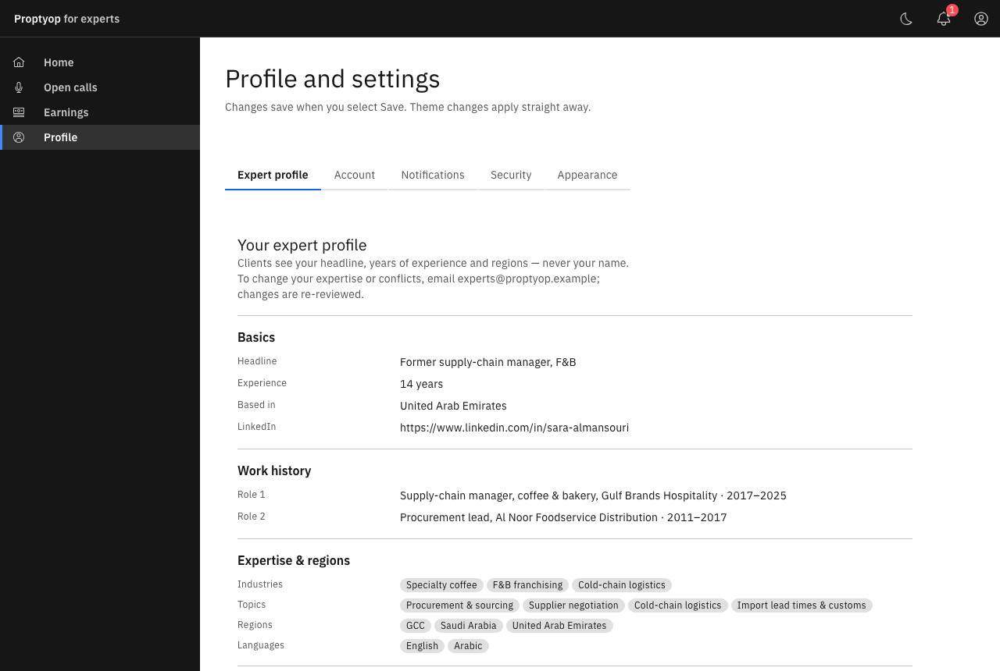    | 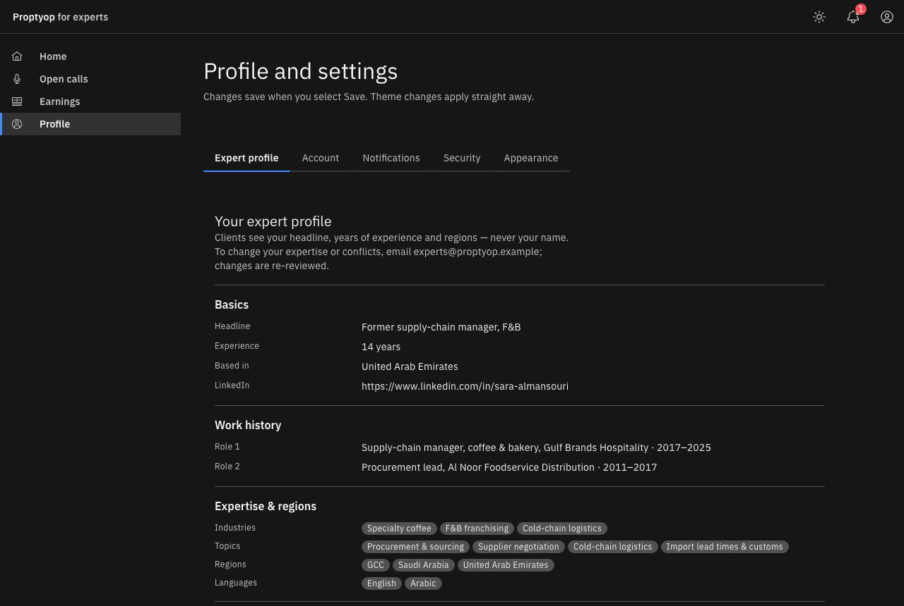    |

## Open / next

- Admin settings page (admins get the notification centre only).
- Respecting preferences when notifications are created (the mock shows everything in-app).
