# F3 ★ Library purchase → read → ask

- Status: Built (prototype) · 2026-10-16
- Routes: `/library` → `/library/[itemId]` (preview, buy) → `/library/[itemId]/read` (viewer + Ask this report)
- Feature: `src/features/library` · Mock: `src/mocks/handlers/library.handlers.ts`, `src/mocks/fixtures/reportContent.ts`, `src/mocks/ai/reportQa/engine.ts`
- E2E: `e2e/F3-library.spec.ts`

## Screens

| Screen  | Key elements                                                                                                                                                                                                                            |
| ------- | --------------------------------------------------------------------------------------------------------------------------------------------------------------------------------------------------------------------------------------- |
| Library | Search (as you type), industry, regions (multi), price cap, “Only reports I own”; applied filters as removable tags + **Clear filters**; result count; **Cards / Table** switch; shelves by industry (largest first) when unfiltered    |
| Card    | Category, title (whole card is the link), summary, experts · regions · date, price in credits + currency, or **Owned** (opens the reader); **Updated** tag when an owned report changed                                                 |
| Preview | Title, summary, sub-industry, expert count, read time, date; what’s inside (numbered sections); a sample chart; who you’ll hear from (anonymous role, years, region); where it comes from (provenance); sticky price card               |
| Buy     | Price card shows balance → **Buy for N credits** → confirm modal (price, balance after) → credits deducted → reader opens with “Report purchased”. Short on credits: warning + inline top-up (F6) instead of the buy button             |
| Reader  | Sticky contents with “you are here”; numbered sections with a lead, key figures, body, charts and verbatim expert quotes tagged with the expert’s role · years · region; provenance; **Download PDF** (mocked); updated-since notice    |
| Ask     | Panel beside the report at `max` widths, above it (toggle) below that; scope tag “this report”; starter questions; streamed answer with step labels; `[n]` citations; sources; feedback; follow-ups; **Stop**; retry keeps the question |

## Ask this report (AI_NATIVE §4)

- Answers come only from the report’s sections; each claim carries a `[n]` citation. Clicking a citation or a source scrolls to that section, focuses its heading and highlights it.
- Not covered → “I couldn’t find this in this report. It covers: …” + **Request research on this** (opens the goal chat).
- Investment-advice questions get a neutral decline plus what the report says, with citations.
- Starter questions come from the server per report, and each one is answerable.
- Charts use Carbon Charts with its toolbar off (its menu nests interactive controls — an axe failure); **Show data as a table** gives the same data accessibly.

## States and how to reach them

| State                                | How                                                                         |
| ------------------------------------ | --------------------------------------------------------------------------- |
| Library / preview / reader loading   | Toolbar _Slow network_                                                      |
| Library failed (retry)               | Toolbar _API error_                                                         |
| No results → describe what you need  | Search “zanzibar”, or toolbar _Empty data_                                  |
| Not owned → reader blocked           | Open `/library/lib_qahwa_ops/read` as Bilal                                 |
| Insufficient credits + inline top-up | Toolbar _Low credits_, open a report over 15 credits                        |
| Owned / updated since purchase       | Ayesha → “UAE consumer retail” (seeded), or toolbar **Update owned report** |
| Answer interrupted (retry)           | _API error_ on, ask a question                                              |
| Stopped answer                       | **Stop** while an answer streams                                            |
| Not in this report                   | Ask “What is the weather like in Abha?”                                     |

## Decisions

- Experts stay anonymous (role, years, region) — open question #1.
- Prices show credits plus currency, e.g. “150 credits (≈ $750)” — open question #3.
- Purchase feedback is an inline success notice at the top of the reader (persistent and announced) rather than a transient toast.
- Q&A history is per visit (not saved) in the prototype.

## Screenshots

1280 × 860 (Ask at 1600 wide), light and dark. Checked at 320px (no horizontal scroll), for a visible focus stop on each Tab, and with axe in both themes.

| Screen                | Light                                                                   | Dark                                                                  |
| --------------------- | ----------------------------------------------------------------------- | --------------------------------------------------------------------- |
| Library shelves       | 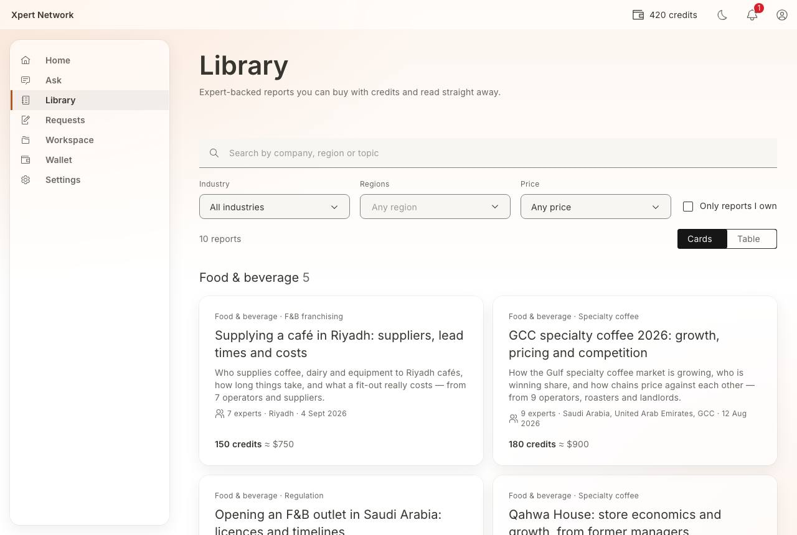             | 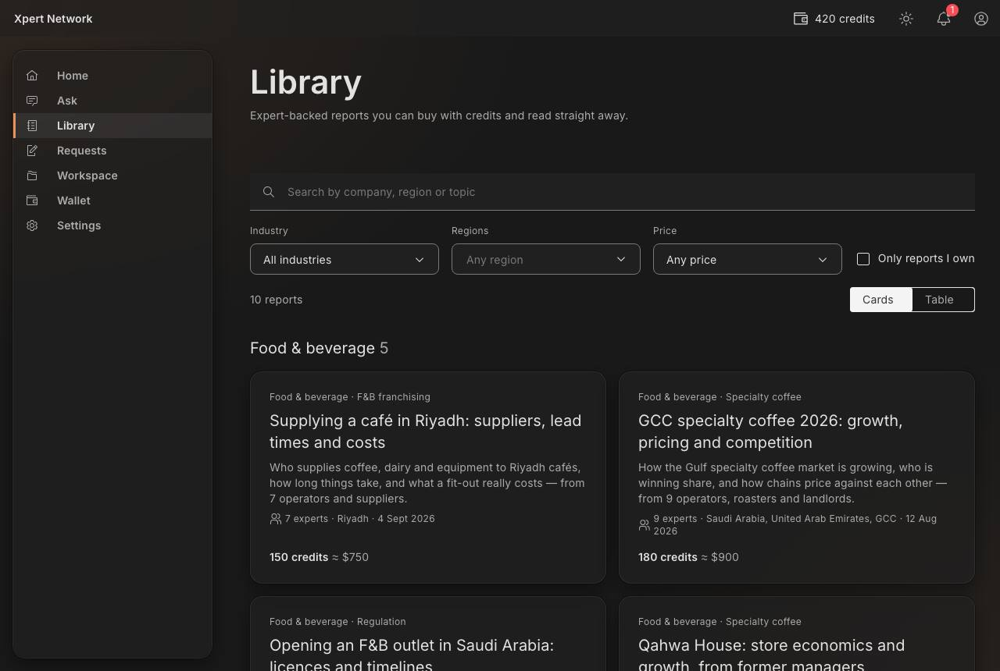             |
| Table view (filtered) | 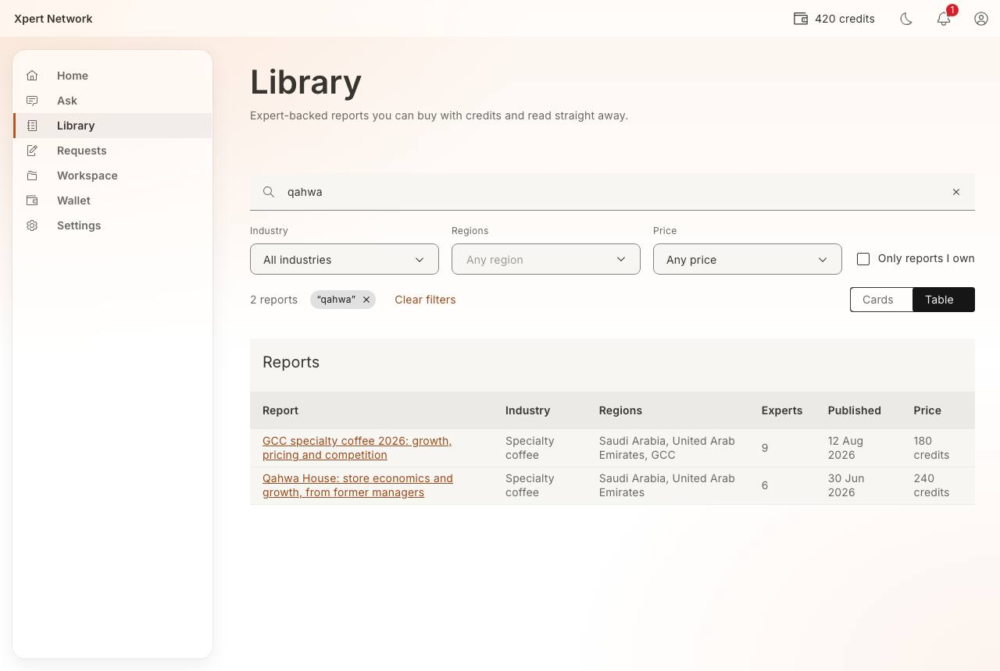 | 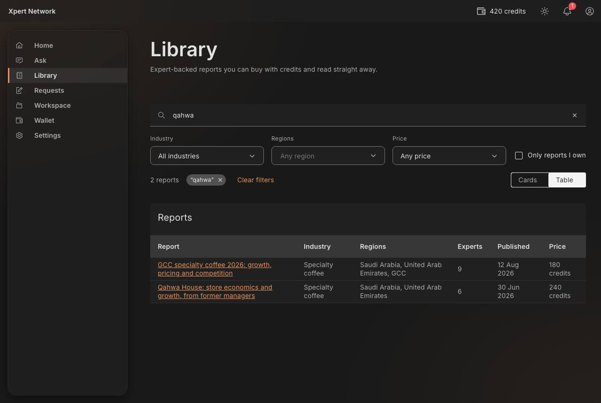 |
| No results            | 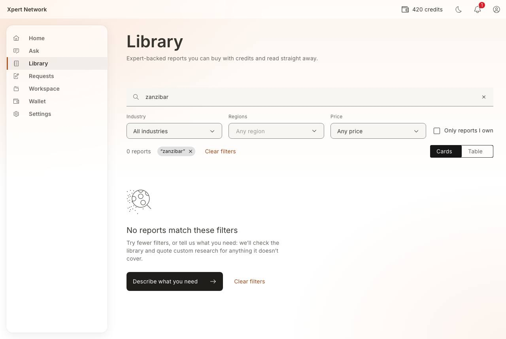            | 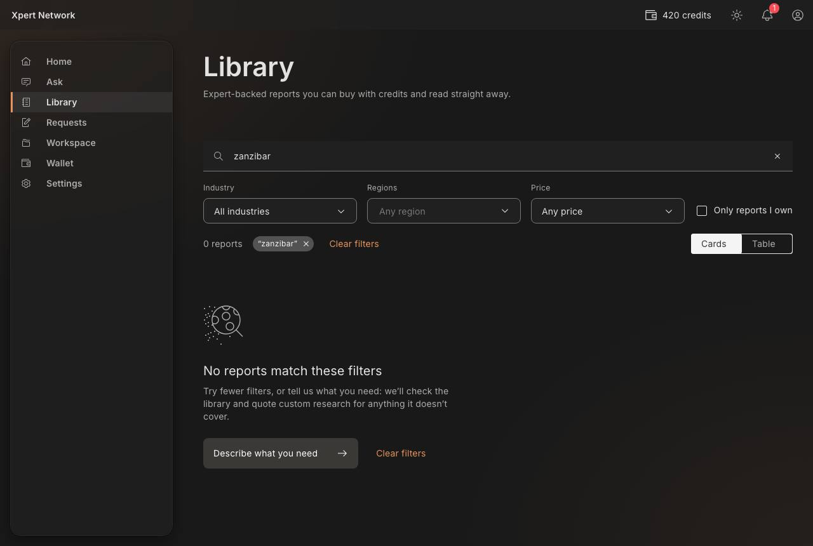            |
| Report preview        | 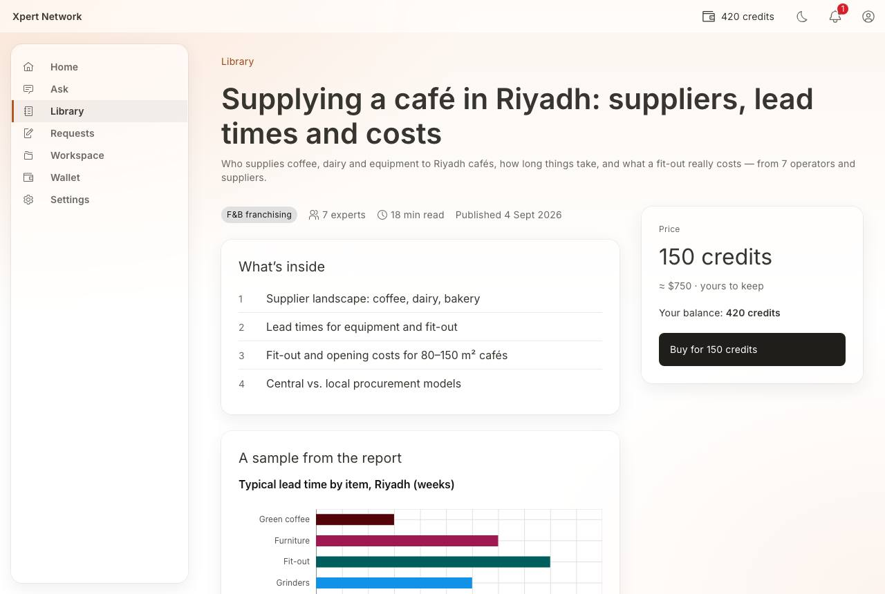              | 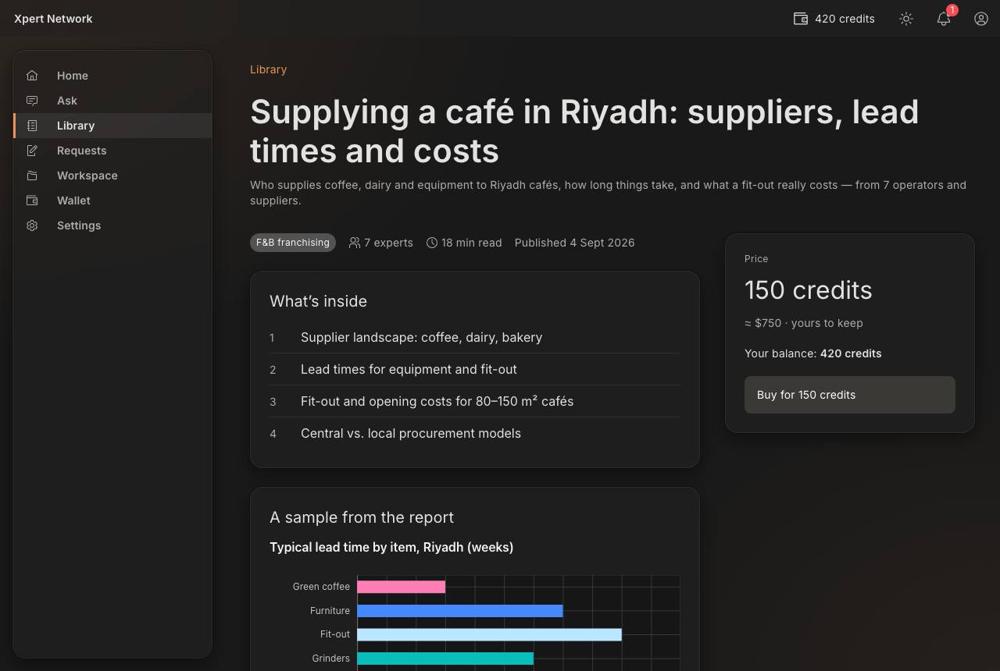              |
| Buy confirmation      | 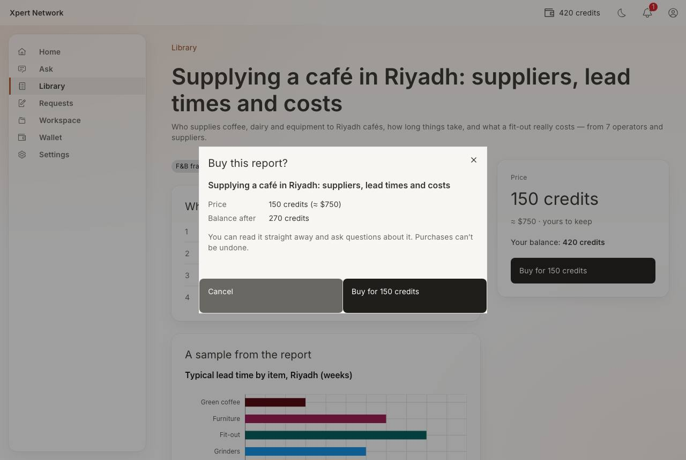        | 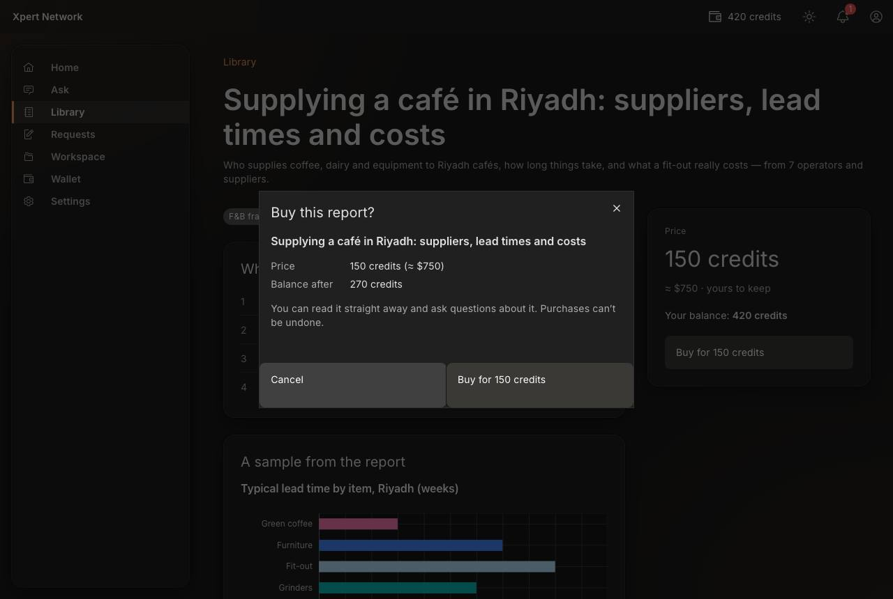        |
| Reader                | 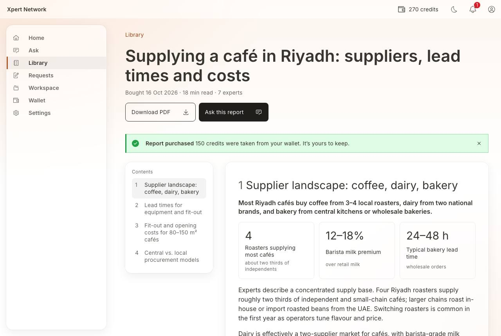                       | 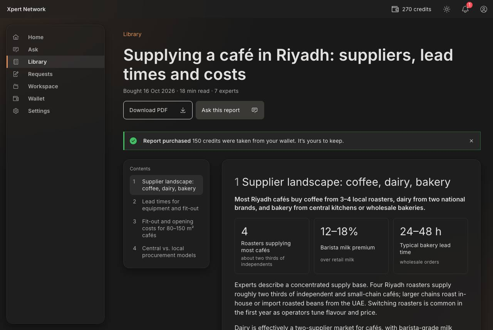                       |
| Ask this report       | 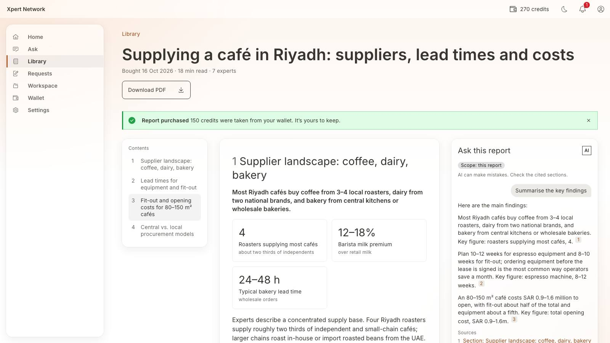                 | 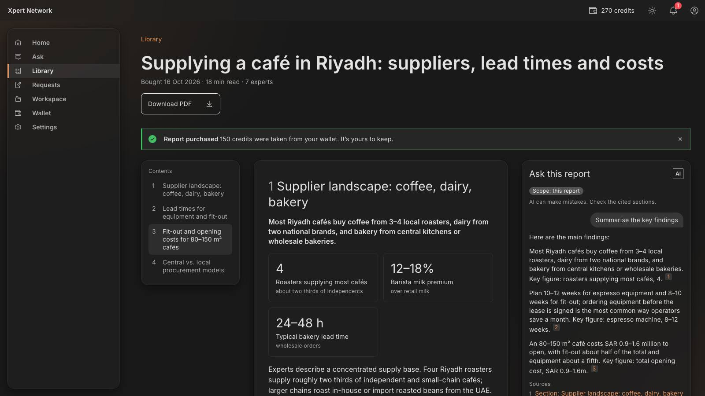                 |

## Open / next

- Save to folder and labels in the reader (F5, phase 4).
- “Report updated” diff view (which figures changed).
