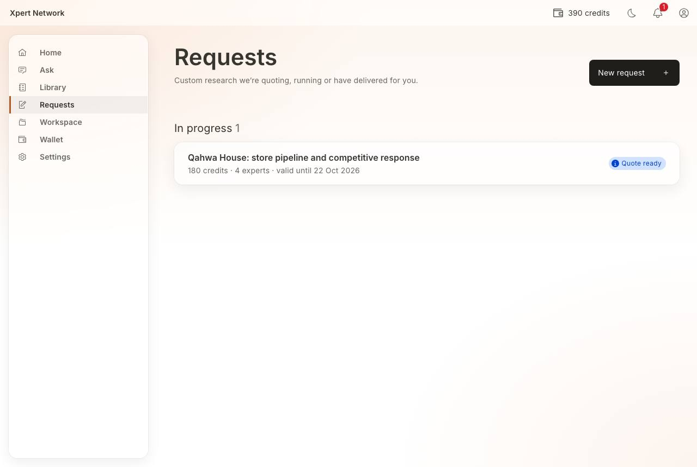
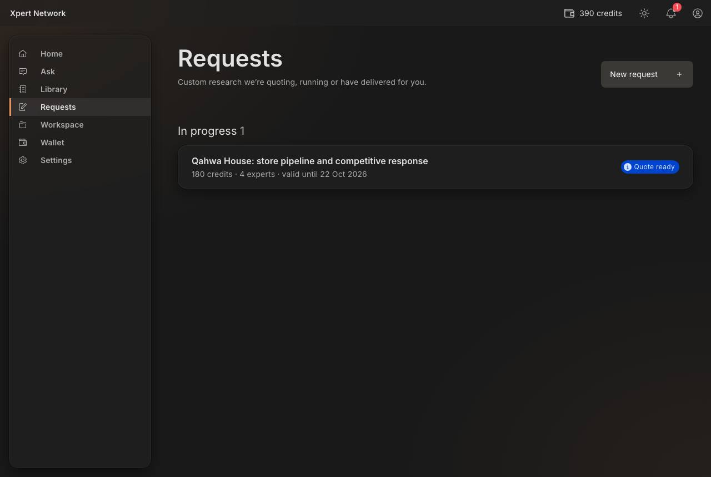
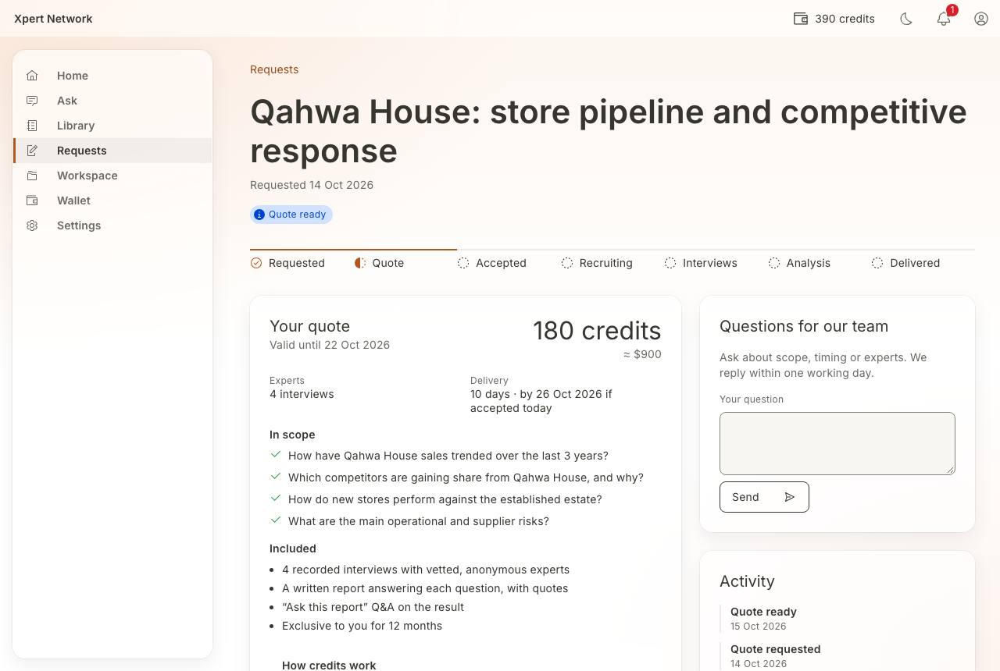
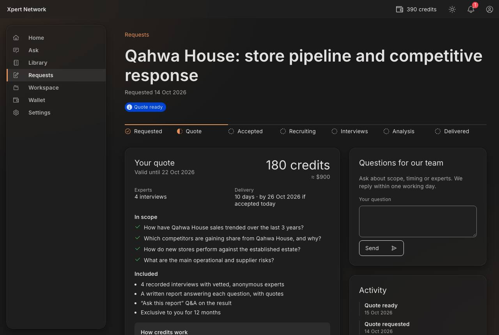
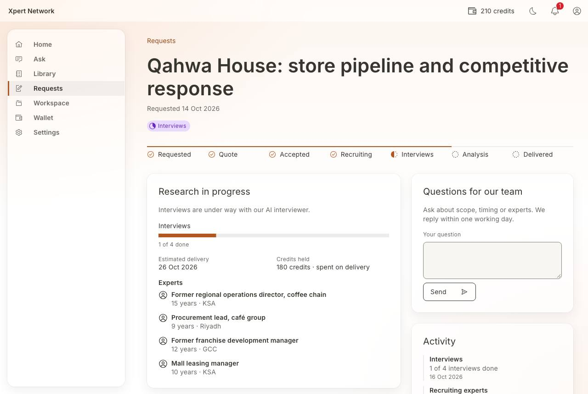
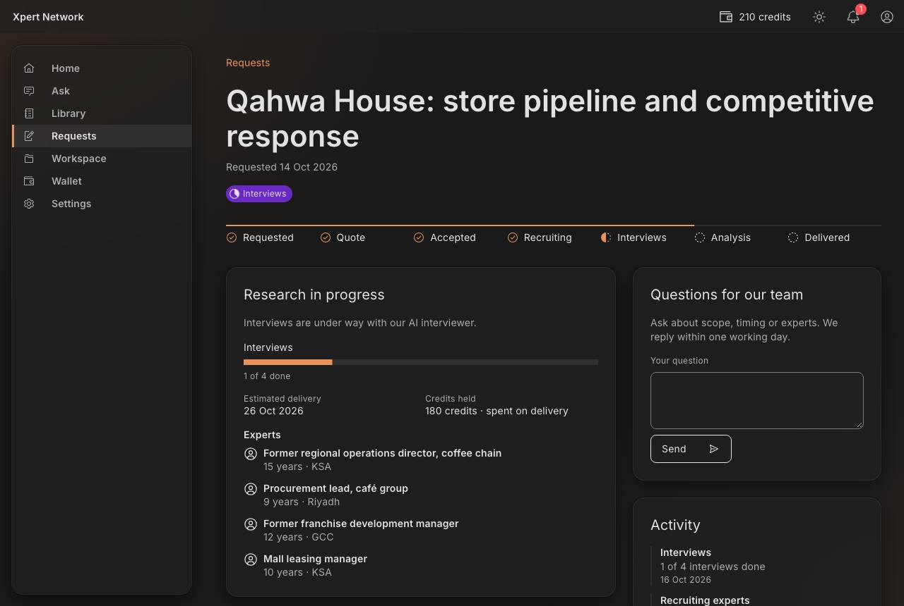
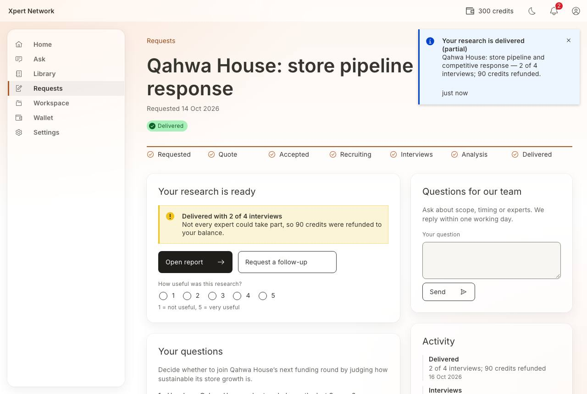
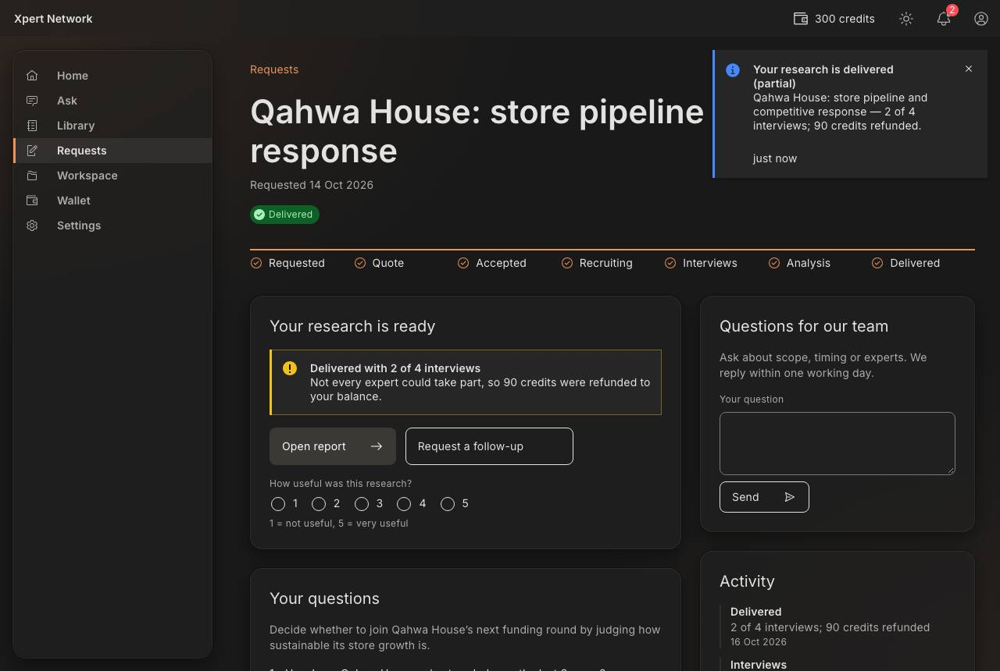

# F4 ★ Custom request → quote → accept → track → delivery

- Status: Built (prototype) · 2026-10-16
- Routes: `/requests` → `/requests/[requestId]`; delivered research opens in the F3 reader (`/library/cus_<requestId>/read`)
- Feature: `src/features/custom-requests` · Mock: `src/mocks/handlers/requests.handlers.ts`, `src/mocks/fixtures/requests.ts`, `src/mocks/scenarios.ts`
- E2E: `e2e/F4-custom-request.spec.ts`

## Entry

Requests are created by the goal chat (F2 step 7, “custom” or “mix”). Ayesha also has a seeded request with a quote waiting (“Qahwa House: store pipeline and competitive response”).

## Screens

| Screen             | Key elements                                                                                                                                                                                            |
| ------------------ | ------------------------------------------------------------------------------------------------------------------------------------------------------------------------------------------------------- |
| Requests           | **New request**; “In progress” and “Closed” groups; each card: title (whole card is the link), one line on what’s next (price and validity, interviews n of m, due date, refund), status tag            |
| Tracker            | Requested → Quote → Accepted → Recruiting → Interviews → Analysis → Delivered (Carbon `ProgressIndicator`); off-track states mark where it stopped; scrolls sideways on phones                          |
| Quote              | Credits + currency, validity; experts and delivery date; questions in scope / not in this quote (with reason); what’s included; **How credits work** (hold → spend on delivery → refund rules)          |
| Quote actions      | **Accept and hold N credits** (confirm: held now, available after, delivery) · **Ask a question** (jumps to messages) · **Decline** (reason + optional comment). Short balance: warning + inline top-up |
| In progress        | Stage sentence, interviews progress bar, estimated delivery, credits held, experts as they join (anonymous: role, years, region), **Cancel request** until interviews start (full refund)               |
| Delivered          | **Open report** (F3 reader, “Ask this report” included), **Request a follow-up**, 1–5 rating; partial delivery notice with the refund                                                                   |
| Expired / declined | Why, plus **Ask for a new quote**                                                                                                                                                                       |
| Side column        | Questions for our team (scripted replies on price, timing, experts) and an activity log                                                                                                                 |

## Credits (F6)

| Event                      | Available | Held    | History row                         |
| -------------------------- | --------- | ------- | ----------------------------------- |
| Accept                     | − quote   | + quote | Held for a quote (−)                |
| Cancel (before interviews) | + quote   | − quote | Refund (+)                          |
| Deliver (full)             | —         | − quote | Spent on research (−, from held)    |
| Deliver (partial)          | + refund  | − quote | Spent (−, from held) and Refund (+) |

## States and how to reach them (prototype toolbar → Scenarios)

| State                                          | How                                                 |
| ---------------------------------------------- | --------------------------------------------------- |
| Quote ready (from a new request)               | **Advance request** on a “Quote requested” request  |
| Recruiting → interviews → analysis → delivered | **Advance request** repeatedly after accepting      |
| Quote revised (cheaper, slower)                | **Revise quote**                                    |
| Quote expired → ask for a new quote            | **Expire quote**                                    |
| Partial delivery with refund                   | **Deliver partially** during interviews or analysis |
| Cancelled with refund                          | **Cancel request** while accepted or recruiting     |
| Not enough credits to accept                   | _Low credits_ on                                    |
| No requests yet                                | Bilal before using the goal chat, or _Empty data_   |
| Loading / error with retry                     | _Slow network_ / _API error_                        |

Quote ready and delivery also arrive as notifications (F17).

## Decisions

- “Held” is explained at the moment of accepting, on the quote and in the wallet, to answer the plan’s ⚑ question “do users understand held vs. spent?”.
- Clients can’t cancel once interviews start (experts are paid per interview); they message the team instead.
- Delivered custom reports reuse the F3 reader so “Ask this report” works the same way.

## Screenshots

1280 × 860, light and dark. Checked at 320px, for visible focus on each Tab stop, and with axe in both themes.

| Screen              | Light                                                             | Dark                                                            |
| ------------------- | ----------------------------------------------------------------- | --------------------------------------------------------------- |
| Requests            |              |              |
| Quote               |                    |                    |
| In progress         |        |        |
| Delivered (partial) |  |  |

## Open / next

- The admin console follows the ExpertNet PRD (`docs/ADMIN_PLAN.md`) and starts from client emails; this client flow stays separate and unchanged. The quote and the scripted replies are still toolbar-driven.
- Custom reports appear in the workspace (F5).
