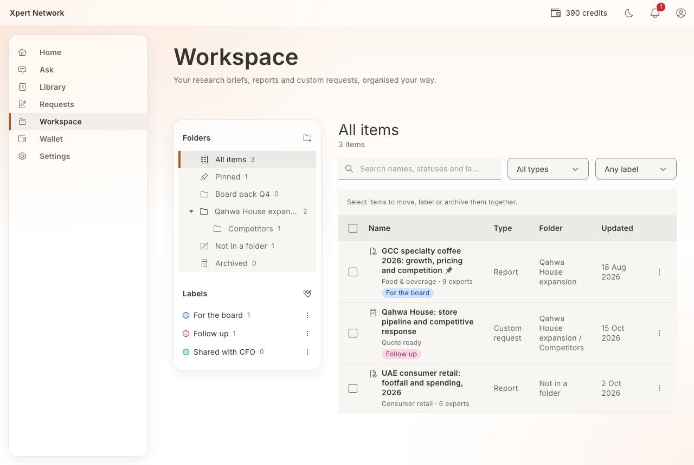
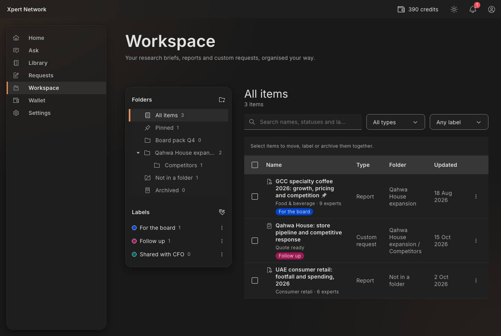
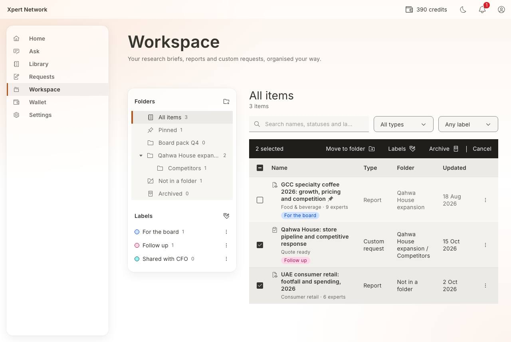
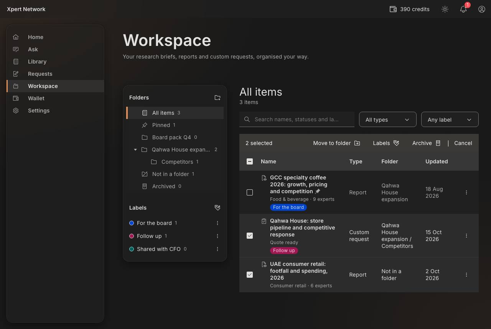
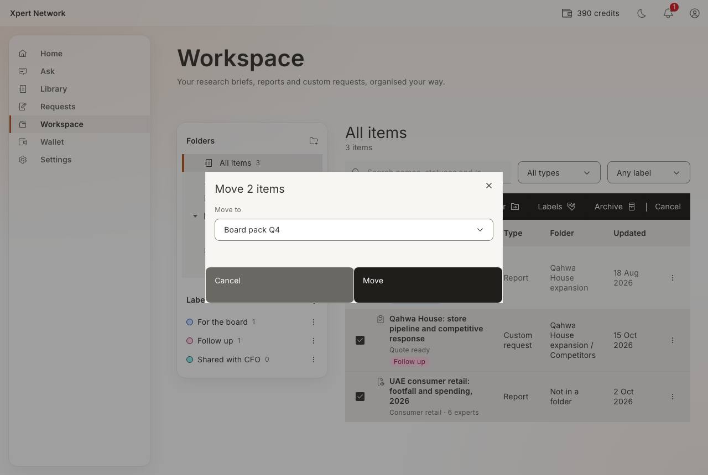
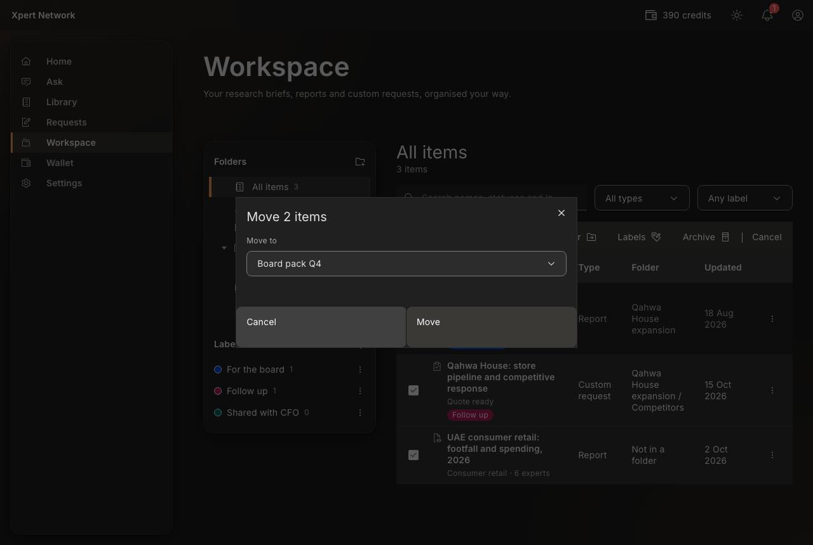
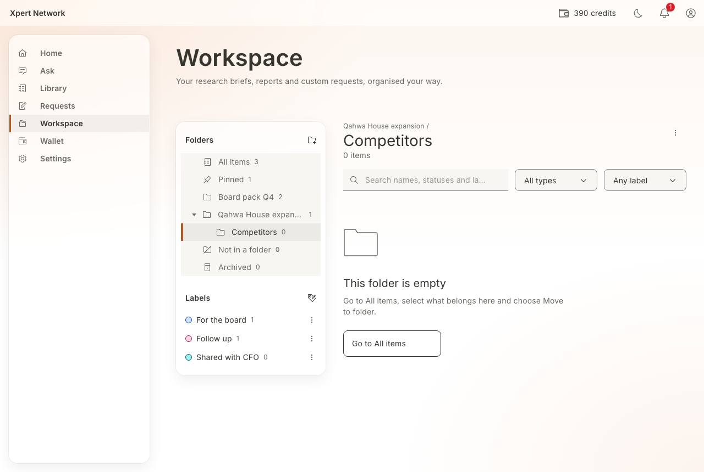
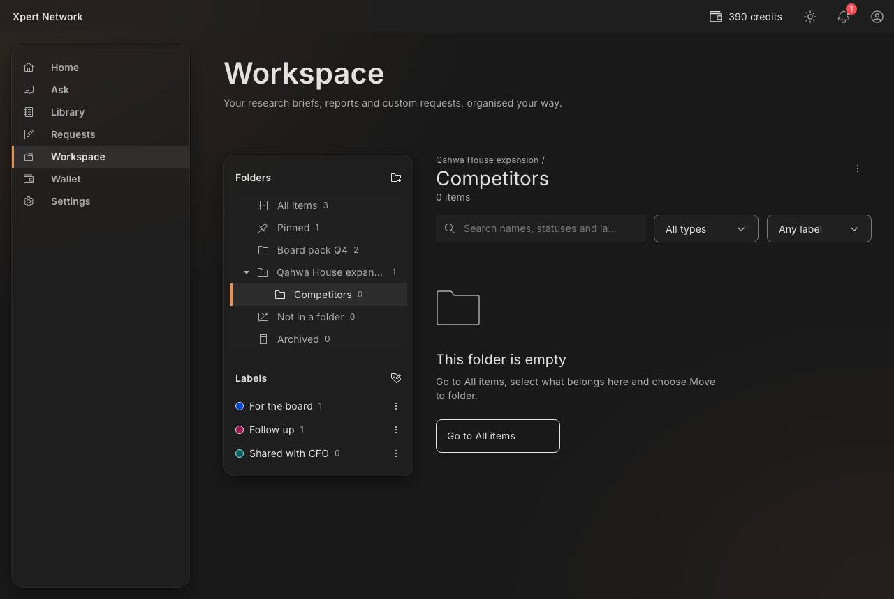

# F5 Workspace: folders, labels, rename, pin, archive, search

- Status: Built (prototype) · 2026-10-16
- Route: `/workspace` (view and filters live in the URL: `?view=<all|pinned|unfiled|archived|folderId>&q=&type=&labels=a,b`)
- Feature: `src/features/workspace` · Mock: `src/mocks/handlers/workspace.handlers.ts`, `src/mocks/fixtures/workspace.ts`
- E2E: `e2e/F5-workspace.spec.ts`

## What's in it

Everything the client owns, gathered automatically:

| Type           | Comes from                                                | Opens                |
| -------------- | --------------------------------------------------------- | -------------------- |
| Research brief | Goal chat (F2), any status                                | `/ask/<briefId>`     |
| Report         | Library purchases (F3) and delivered custom research (F4) | `/library/<id>/read` |
| Custom request | Requests (F4), with its current status                    | `/requests/<id>`     |

The workspace only stores the client's own organisation per item (folder, labels, pinned, archived, a custom name). Nothing in the workspace deletes research.

## Screens

| Area        | Key elements                                                                                                                                                                                                                                                                                                        |
| ----------- | ------------------------------------------------------------------------------------------------------------------------------------------------------------------------------------------------------------------------------------------------------------------------------------------------------------------- |
| Side column | **Folders**: All items, Pinned, folders (two levels), Not in a folder, Archived, each with a count; **New folder**. **Labels**: colour + name + count; click to filter (pressed state); menu to edit or delete; **New label**. Below `lg` the tree becomes a “Show” select and the side column sits above the list. |
| View header | Folder path, name, item count (“2 of 3 items” when filtered); folder menu: New subfolder (top level only), Rename, Move, Delete                                                                                                                                                                                     |
| Filters     | Search (names, statuses, label names), Type, Labels (all chosen labels must match), Clear filters                                                                                                                                                                                                                   |
| Table       | Select rows → **Move to folder · Labels · Archive** (Archived view: **Restore**); type icon, name (link), pin mark, status line, label tags; Type, Folder and Updated columns from `md`/`lg`; row menu: Rename, Move to folder, Labels, Pin/Unpin, Archive                                                          |
| Dialogs     | New/rename folder (name ≤ 60, unique among siblings, choose parent), move folder, delete folder (says how many items move out), new/edit label (name ≤ 30, colour with preview), delete label, move items, labels for items (tri-state for mixed selections), rename item (“Use the original name”)                 |

Pinned items sort first, then the most recently updated. A folder view includes its subfolders' items.

## Reversible by default

Every item change shows a status line; move, labels, rename, archive and restore offer **Undo**, which puts each item back exactly as it was (per-item folder, labels, pin). Deleting a folder moves its items to “Not in a folder”; deleting a label only takes it off items.

## States and how to reach them

| State                                              | How                                                                         |
| -------------------------------------------------- | --------------------------------------------------------------------------- |
| First use (nothing at all)                         | _Empty data_ on, or a new client before using the goal chat                 |
| Empty folder / Pinned / Archived / Not in a folder | Open the view with nothing in it (e.g. **Board pack Q4** for Ayesha)        |
| No matches                                         | Search for something that isn't there → **Clear filters**                   |
| Loading                                            | _Slow network_                                                              |
| Error with retry                                   | _API error_ (a failed change shows an inline error and keeps the selection) |

## Decisions

- Folders go two levels deep (plan §F5). A folder with subfolders stays at the top level; the mock enforces it too.
- Uses Carbon `TreeView` with the `enable-treeview-controllable` flag so the selected view follows the URL, and `enable-focus-wrap-without-sentinels` so the undo notification adds no invisible Tab stops.
- On phones the bulk actions become icon-only (with tooltips); under 360px Labels leaves the bulk bar and stays in each row's menu.
- The batch-action bar uses `background-brand`, now the same near-black as primary buttons instead of orange.

## Screenshots

1280 × 860, light and dark. Checked at 320px, for visible focus on each Tab stop, and with axe in both themes.

| Screen       | Light                                                         | Dark                                                        |
| ------------ | ------------------------------------------------------------- | ----------------------------------------------------------- |
| All items    |        |        |
| Bulk select  |    |    |
| Move dialog  |    |    |
| Empty folder |  |  |

## Open / next

- “Save to folder” from the report reader and request detail.
- Drag and drop between folders (keyboard alternative already exists: Move to folder).
