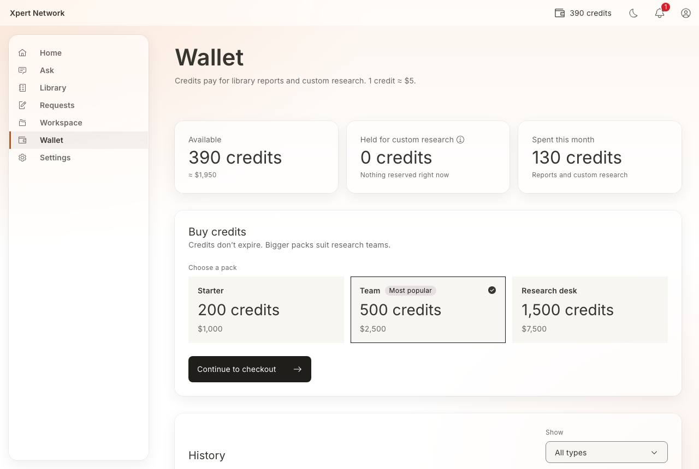
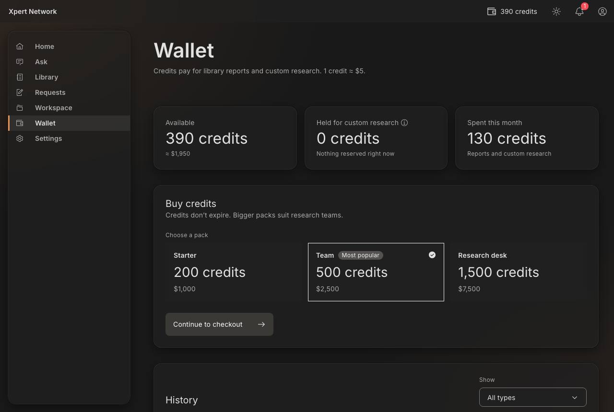
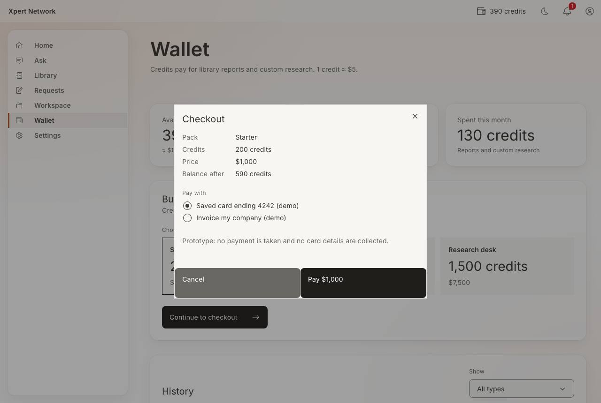
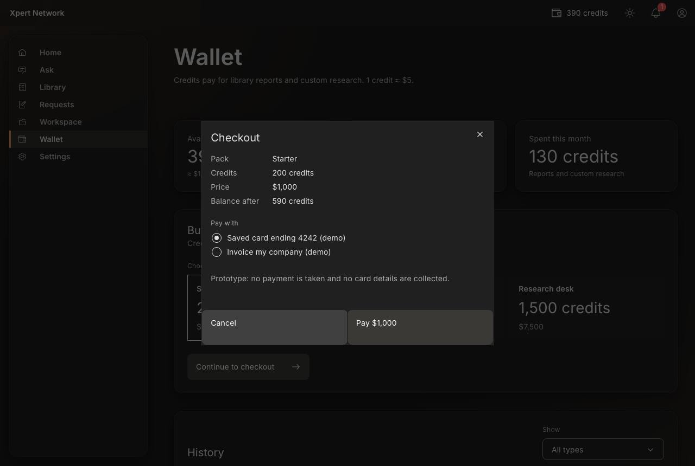

# F6 Wallet

- Status: Built (prototype) · 2026-10-16
- Route: `/wallet` (header balance badge links here; low-balance banner’s **Top up** too)
- Feature: `src/features/wallet` (`WalletOverview`, `TopUpPanel`, `BalanceBadge`) · Mock: `src/mocks/handlers/wallet.handlers.ts`, `src/mocks/fixtures/wallet.ts`
- E2E: `e2e/F6-wallet.spec.ts`

## Screen

| Area             | Key elements                                                                                                                                                                       |
| ---------------- | ---------------------------------------------------------------------------------------------------------------------------------------------------------------------------------- |
| Balance          | **Available** (credits + currency), **Held for custom research** (toggletip: reserved when a quote is accepted; spent on delivery, refunded on cancellation), **Spent this month** |
| Buy credits      | Three packs as radio tiles (Starter 200 · Team 500 “Most popular”, preselected · Research desk 1,500) with credits and price → **Continue to checkout**                            |
| Checkout (modal) | Pack, credits, price, balance after; pay with a saved demo card or company invoice → **Pay $N** → success notice “N credits added. Your balance is now …”                          |
| History          | Date (full time on hover), description, type tag (Top-up, Report purchase, Held for a quote, Spent on research, Refund), signed credits (right-aligned); **Show** filter by type   |

The same packs appear inline wherever a balance is too short (goal chat checkout, report preview) via `TopUpPanel`. The low-balance banner (below 50 credits) shows across client pages.

## States and how to reach them

| State                                 | How                          |
| ------------------------------------- | ---------------------------- |
| Loading skeletons                     | Toolbar _Slow network_       |
| Wallet / packs failed (retry)         | Toolbar _API error_          |
| Payment failed (not charged)          | _API error_ on, then **Pay** |
| No transactions yet                   | Toolbar _Empty data_         |
| Filtered history empty → **Show all** | **Show → Refund**            |
| Low balance banner                    | Toolbar _Low credits_        |

## Decisions

- No real payment is taken and no card details are entered: the checkout offers a saved **demo** card or an invoice, and says so.
- 1 credit ≈ US$5 for every pack (no volume discount yet); prices show both.
- Held credits are always visible (0 until F4) so the concept is learnt before a quote is accepted.

## Screenshots

1280 × 860 (Ask at 1600 wide), light and dark. Checked at 320px (no horizontal scroll), for a visible focus stop on each Tab, and with axe in both themes.

| Screen   | Light                                                 | Dark                                                |
| -------- | ----------------------------------------------------- | --------------------------------------------------- |
| Wallet   |      |      |
| Checkout |  |  |

## Open / next

- Holds, spend and refunds arrive with custom requests (F4).
- Receipts / invoices download.
