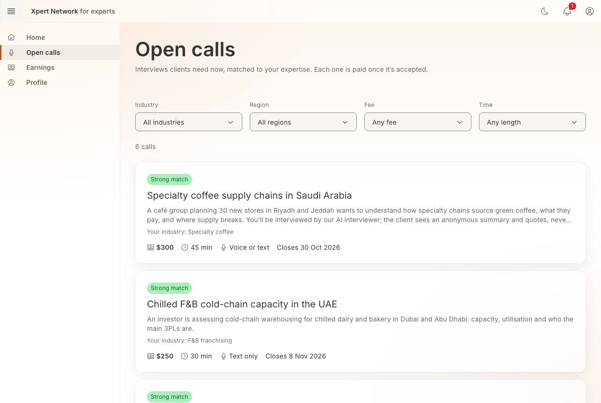
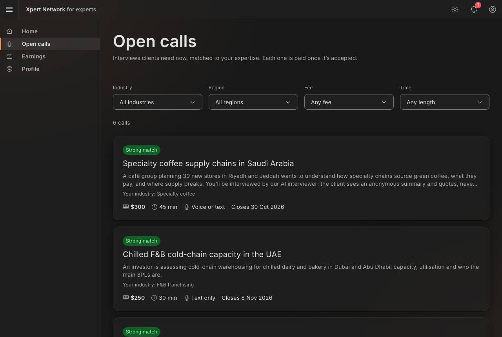
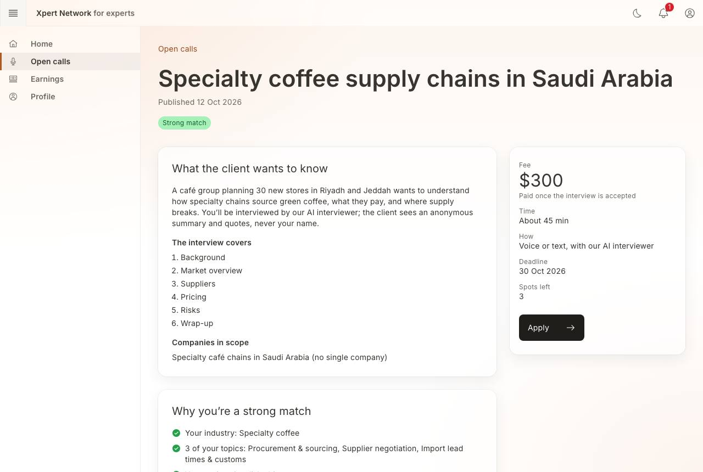
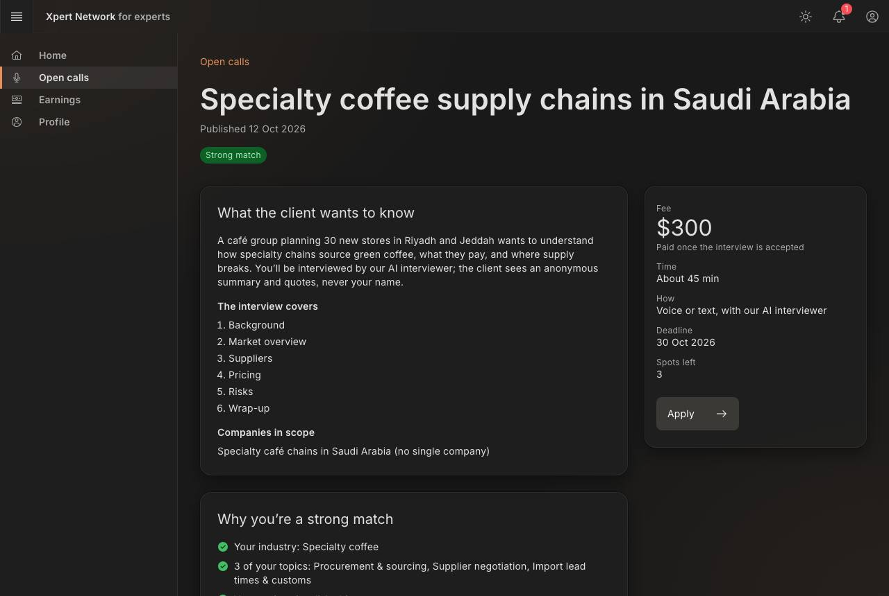
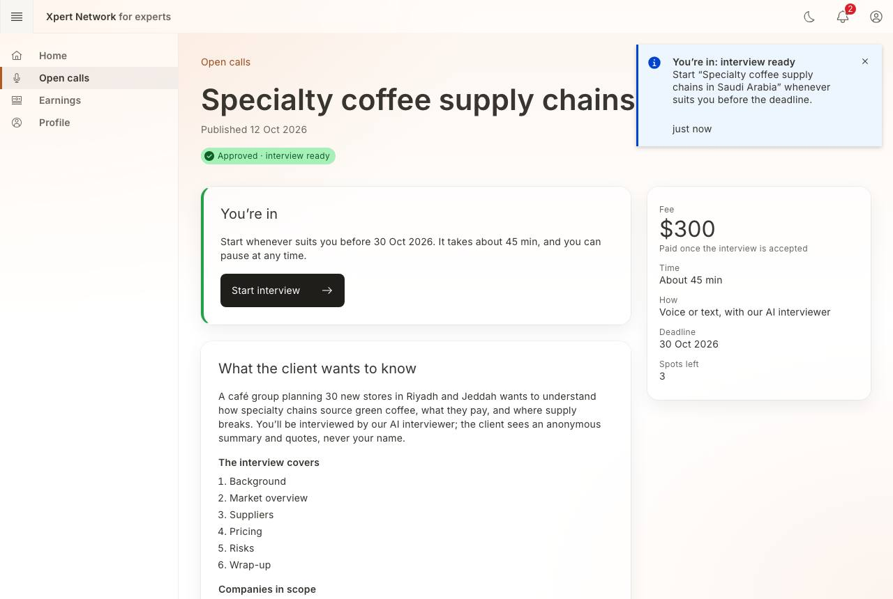
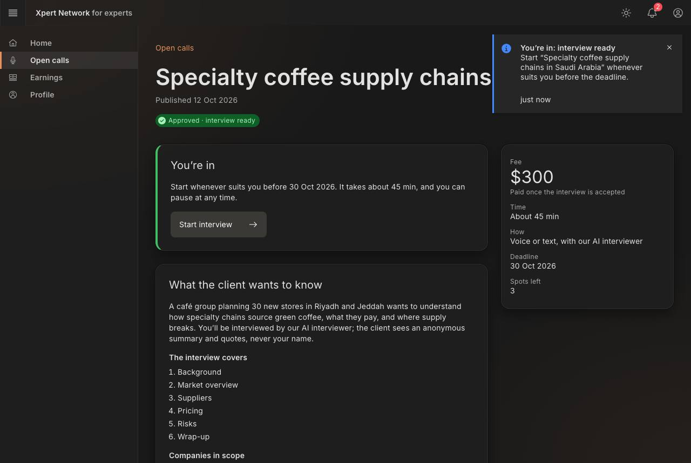
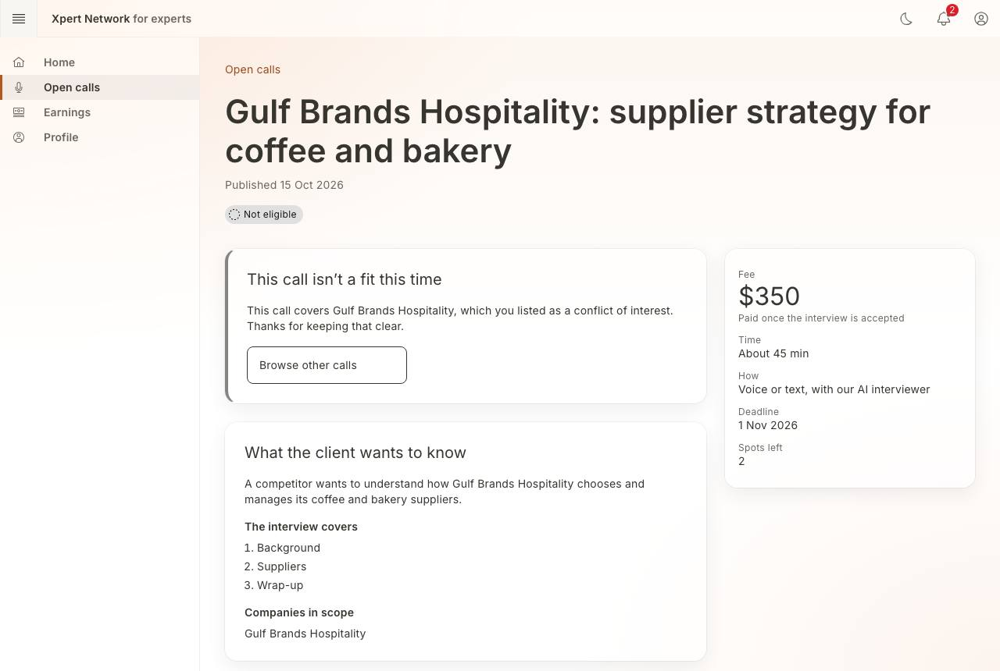
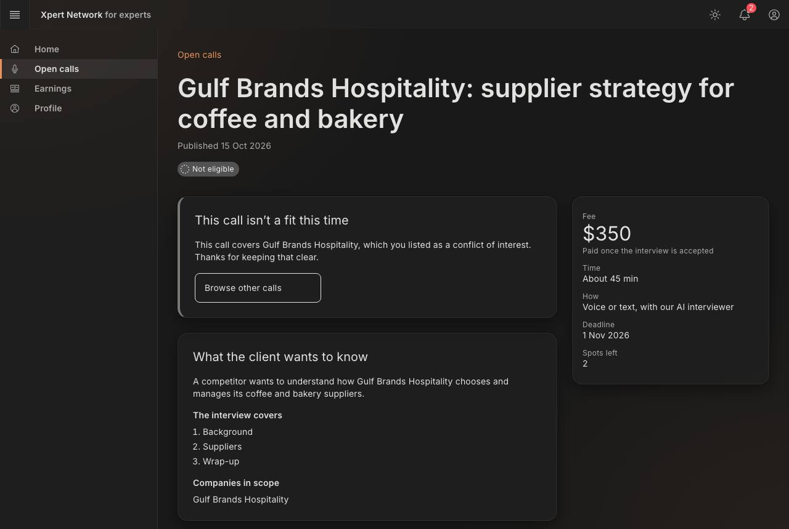

# F8 Open calls: browse → detail → screening → apply

- Status: Built (prototype) · 2026-10-16
- Routes: `/expert/calls` (filters in the URL: `?industry=&region=&minFee=&maxMinutes=`) → `/expert/calls/[callId]`
- Feature: `src/features/open-calls` · Mock: `src/mocks/handlers/calls.handlers.ts`, `src/mocks/fixtures/calls.ts`
- E2E: `e2e/F8-open-calls.spec.ts`

## Screens

| Screen      | Key elements                                                                                                                                                                                                                                                                          |
| ----------- | ------------------------------------------------------------------------------------------------------------------------------------------------------------------------------------------------------------------------------------------------------------------------------------- |
| Open calls  | Industry, region, fee floor and time cap filters; count and **Clear filters**; cards (whole card is the link) with match tag (Strong / Good / Partial), **Evergreen** tag, application status, two-line brief, the top match reason, fee, time, mode, deadline. Strongest match first |
| Call detail | Fee, time, mode, deadline and spots first (side column from `lg`); what the client wants to know; the interview's sections; companies in scope; **Why you're a … match** with every reason; screening questions (yes/no, choice, short text)                                          |
| Outcomes    | **You're in** → Start interview (F9) · **Application under review** · **This call isn't a fit this time** with the reason → Browse other calls                                                                                                                                        |

## Matching

Scored against the expert's F7 profile: industry +40, each shared topic +20 (max 45), region (including parent regions, so GCC covers Riyadh) +15. Strong ≥ 75, good ≥ 50. The card shows the first reason; the detail page shows all of them (a fit score with reasons, not just a number).

## Eligibility (mock rules)

1. A company in scope that the expert listed as a conflict → not eligible, with a thank-you for keeping it clear (Sara and _Gulf Brands Hospitality_).
2. A required screening answer not met → not eligible, with what the call needs.
3. Calls marked for review → applied; the toolbar's **Approve application** approves the oldest one.
4. Otherwise approved straight away; the interview is created and a notification sent.

## States and how to reach them

| State                                 | How                                                                                                                          |
| ------------------------------------- | ---------------------------------------------------------------------------------------------------------------------------- |
| No calls                              | _Empty data_                                                                                                                 |
| No matches                            | Filters with nothing in range, e.g. $300+ and up to 30 min                                                                   |
| Under review → approved               | Apply to _Chilled F&B cold-chain capacity in the UAE_, or see the seeded franchise application; then **Approve application** |
| Not eligible (conflict / requirement) | Apply to the Gulf Brands call, or answer “No” on the coffee call                                                             |
| Closed call                           | Any unknown call id (not-found state)                                                                                        |
| Loading / error                       | _Slow network_ / _API error_                                                                                                 |

## Screenshots

1280 × 860, light and dark. Checked at 320px, for visible focus on each Tab stop, and with axe in both themes.

| Screen       | Light                                                         | Dark                                                        |
| ------------ | ------------------------------------------------------------- | ----------------------------------------------------------- |
| Open calls   |      |      |
| Call detail  |    |    |
| Approved     |          |          |
| Not eligible |  |  |
