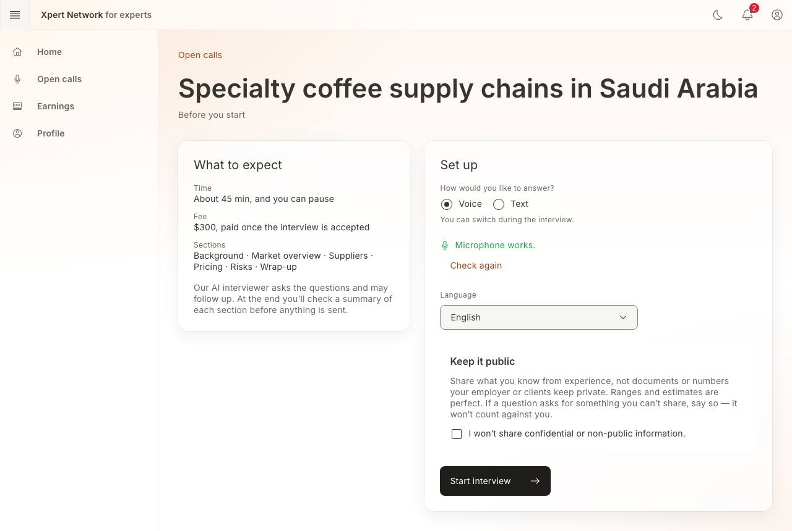
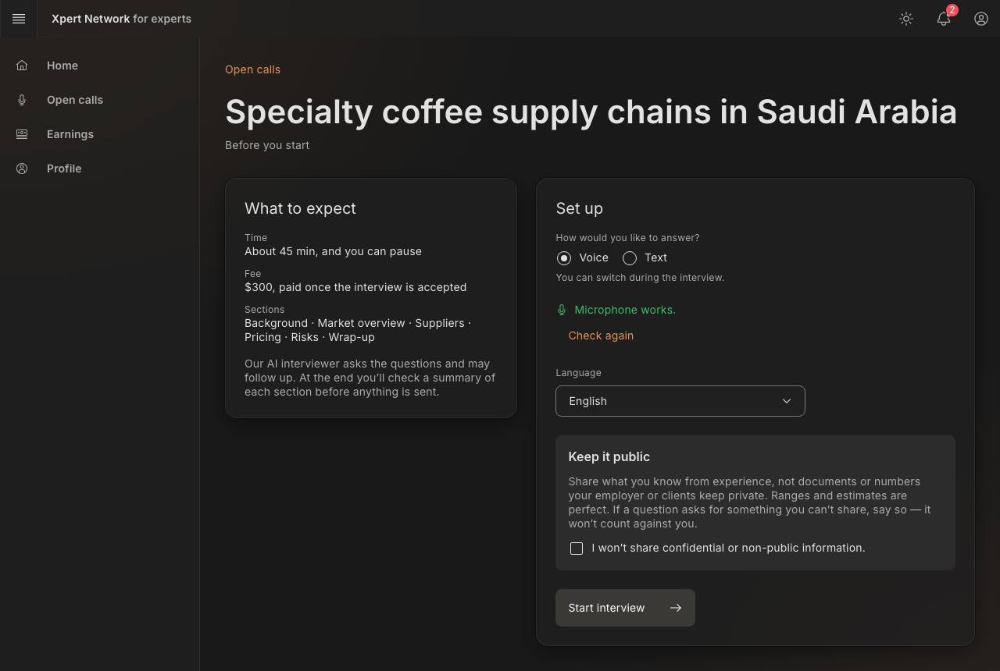
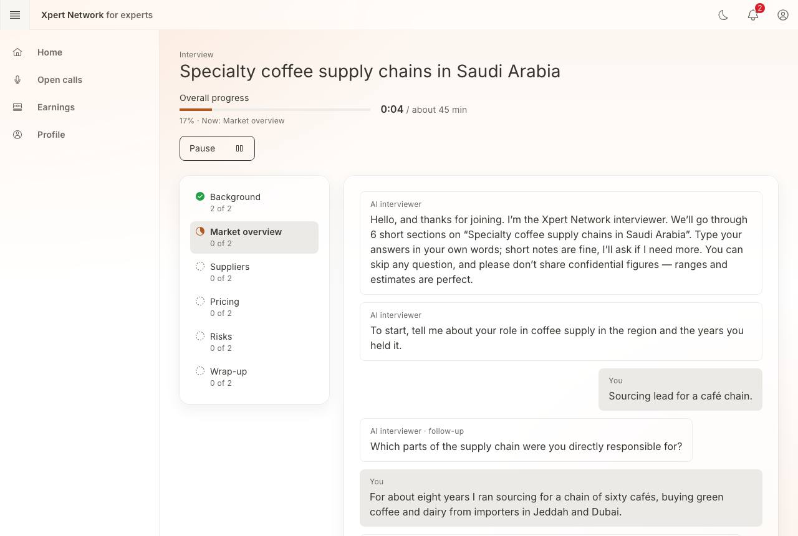
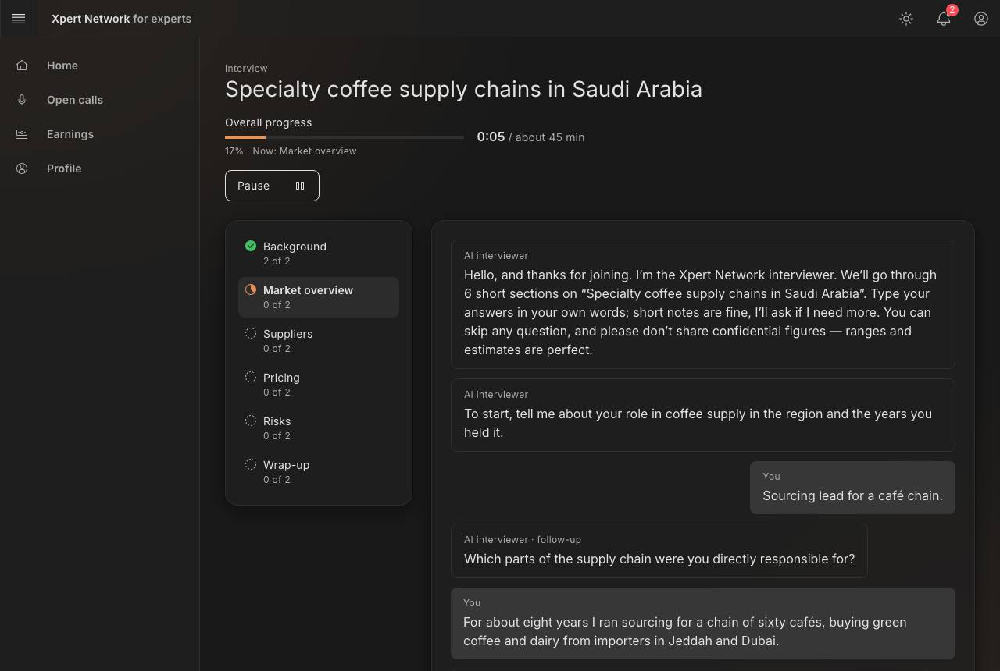
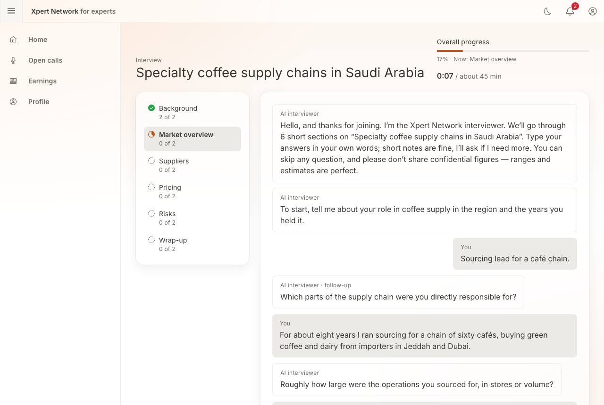
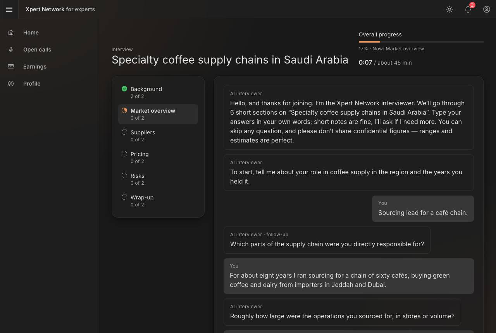
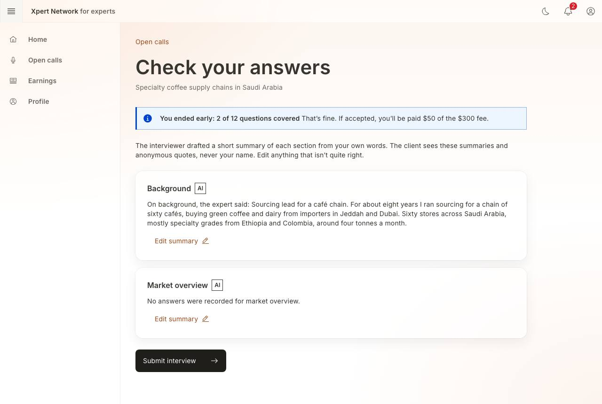
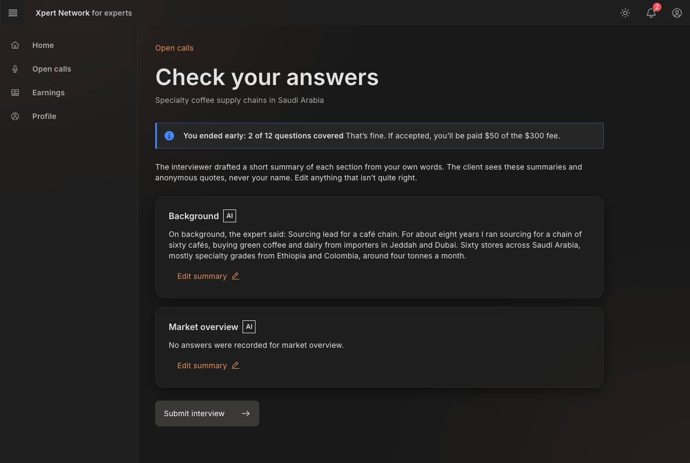
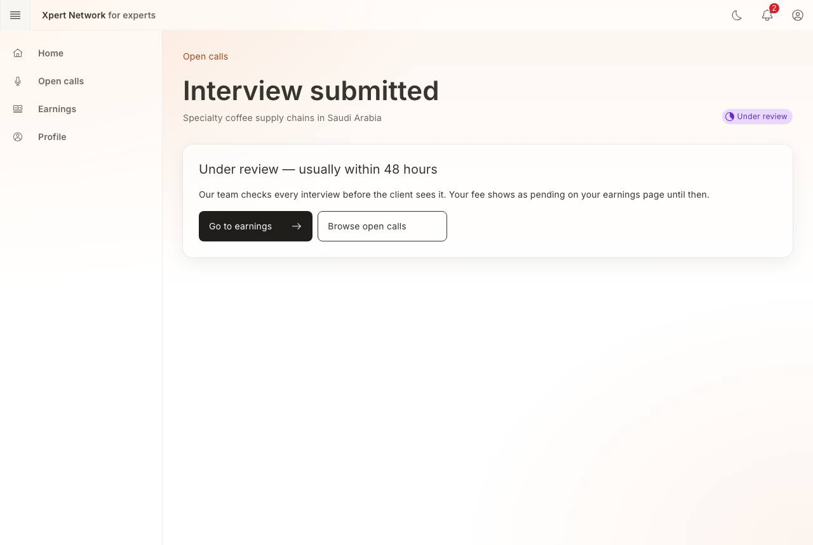
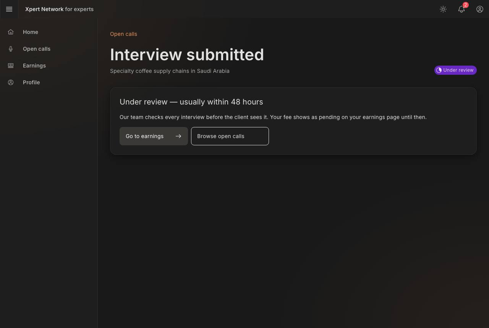

# F9 ★ Interview room: voice or text, sections, review, submit

- Status: Built (prototype) · 2026-10-16
- Route: `/expert/interviews/[interviewId]` — one route; the stage follows the interview status (ready → in progress ⇄ paused → review → submitted → accepted / rejected)
- Feature: `src/features/interviews` · Mock: `src/mocks/handlers/interviews.handlers.ts`, scripted interviewer `src/mocks/ai/interviewer/engine.ts`, guides in `src/mocks/fixtures/calls.ts`
- E2E: `e2e/F9-interview-room.spec.ts`

## Stages

| Stage      | Key elements                                                                                                                                                                                                                                                                                                                                                                                                                                                      |
| ---------- | ----------------------------------------------------------------------------------------------------------------------------------------------------------------------------------------------------------------------------------------------------------------------------------------------------------------------------------------------------------------------------------------------------------------------------------------------------------------- |
| Pre-flight | Time, fee (paid once accepted), sections; **Voice / Text**; microphone check for voice; language; “Keep it public” reminder and the required confirmation                                                                                                                                                                                                                                                                                                         |
| Room       | Title, overall progress bar with the current section, elapsed time (pauses don't count), **Pause**. Sections with status and “n of m” beside the conversation from `lg`. Transcript: interviewer, follow-ups, **Compliance reminder**, your answers, “section complete” markers; streamed replies. Composer with **Send answer** (voice: **Done**), **Skip question** (with a reason), **I can't answer — confidential**; **Switch to voice/text**, **End early** |
| Voice      | The interviewer is read aloud with speech synthesis (speaking indicator, **Replay question**). Where the browser has speech recognition, **Start answering** turns speech into editable text; otherwise you type and questions are still read aloud                                                                                                                                                                                                               |
| Review     | AI-drafted summary per section (labelled, with what it was based on), **Edit summary**, “Edited by you”, revert to the AI draft; partial notice when ended early; **Submit interview**                                                                                                                                                                                                                                                                            |
| Submitted  | “Under review — usually within 48 hours”, fee pending; later accepted (fee approved) or not accepted (with the reason)                                                                                                                                                                                                                                                                                                                                            |

## The interviewer (scripted)

- Answers under 12 words get one follow-up; then it moves on.
- An exact figure (“exactly”, “internal”, a decimal amount in SAR/AED/USD, %, m) that isn't a range is **left out of the record** — the transcript shows “Shared an exact figure — removed from the record” — and the interviewer asks politely for a range. Nothing of the figure is stored.
- Skips and “can't answer” move on and are recorded as such; they don't count against the expert.
- Resuming after a pause repeats where you were (“Welcome back. We were on …”).

## States and how to reach them (prototype toolbar)

| State                                         | How                                                                                        |
| --------------------------------------------- | ------------------------------------------------------------------------------------------ |
| Mic denied → offer text                       | _Mic denied_ toggle, then choose Voice in pre-flight                                       |
| Connection lost → resume at the same question | **Drop connection**, then answer; **Resume** replays the same turn (idempotent by turn id) |
| Paused > 10 minutes                           | **Pause 15 minutes** (“Still there?”)                                                      |
| Ended early (partial, paid pro rata)          | **End early** in the room                                                                  |
| Accepted / not accepted                       | **Accept interview** / **Reject interview** after submitting                               |
| Expert ineligible (conflict)                  | Handled at F8 before an interview exists                                                   |
| Loading / error                               | _Slow network_ / _API error_                                                               |

## Decisions

- The section list is a plain list, not Carbon's ProgressIndicator: its steps are buttons, which added six Tab stops that do nothing here.
- The connection-lost recovery sits below the notification (Carbon notifications can't contain buttons).
- Fee for a partial interview = fee × questions covered ÷ questions planned.

## Screenshots

1280 × 860, light and dark. Checked at 320px, for visible focus on each Tab stop, and with axe in both themes.

| Screen                          | Light                                                                               | Dark                                                                              |
| ------------------------------- | ----------------------------------------------------------------------------------- | --------------------------------------------------------------------------------- |
| Pre-flight                      |                             |                             |
| Room with a compliance reminder |  |  |
| Paused                          |                                    |                                    |
| Review                          |                                    |                                    |
| Submitted                       |                              |                              |
